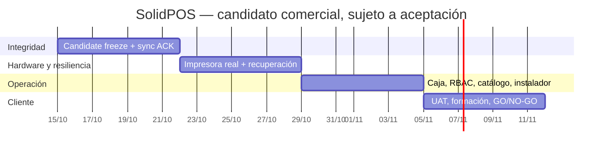

# SolidPOS / AC-DEV — Roadmap de ingeniería a MVP comercial (auditado contra código)

**Corte:** 2026-10-14 · **Repositorio:** `risejoaquin/FULL-METAL-CASH` · **Base examinada:** `AC-DEV@a2961f4e14ebe0a18ec1c6a93db5ca3b6ac73655` · **Estado comercial:** **NO-GO**.
**Objeto vendible V1:** POS Windows WPF, una tienda y terminal, cobro **en efectivo MXN**, SQLite offline-first, cierre y conciliación, recibo físico, sincronización probada con servidor, instalación y respaldo operativos. No prometer tarjeta, multi-sucursal ni hardware no certificado en este primer paquete. **Fechas objetivo, no fechas aprobadas de liberación**.

> Este es el plan de ingeniería accionable que **complementa** [plan general](../COMMERCIAL_MVP_EXECUTION_PLAN.md) y la [matriz de aceptación](../engineering/solidpos-mvp-acceptance-matrix.json). Los nombres de archivos y pruebas constituyen trazabilidad de inspección estática; una afirmación «existe código» no significa «función certificada con dispositivo real». Releer SHA, CI y PR antes de cada iteración.

## 1. Línea base técnica: lo que YA existe frente a lo no demostrado

| Dominio | Estado sustentado | Evidencia de código o pruebas | Brecha comprobable |
|---|---|---|---|
| Arranque WPF y aislamiento | Implementación + tests | `src/PosCore/SolidPOS.PosCore.Wpf/`; `PosCoreStartupInspectionTests.cs` | Instalador, Windows limpio, WAL y restauración física (`START-05`) |
| Autenticación local/RBAC | Implementación + tests | `LocalAuthService.cs`, `LocalAuthServiceTests.cs`, `ProductionCheckoutViewModel.cs` | Operadores reales, logout, caducidad offline, tienda ajena (`AUTH-05`) |
| Catálogo/carro | Implementación + tests | `CatalogCacheServiceTests.cs`; `ProductionCheckoutViewModelTests.cs` | 2 SKU, variantes, agotado e invalidación de precio en WPF (`CAT-05`) |
| Cobro efectivo atómico | Implementado/testeado; UAT simple registrada | `SQLiteAtomicCashCheckoutStore.cs`, `SQLiteAtomicCashCheckoutTests.cs`, `docs/engineering/qa/2026-10-14-local-cash-checkout-uat.md` | Reintento intencional, flujo físico y doble confirmación (`SALE-05`) |
| Caja | Apertura/cierre atómico y un cierre UAT | `SQLiteAtomicCashShiftCloseStore.cs`, `ProductionCheckoutViewModelTests.cs` | Múltiples ventas, retiro, diferencia, auditoría y turno completo (`CASH-04`) |
| Crash / resolución supervisada | Código y regresiones automatizadas | `SQLiteCheckoutRecoveryJournal.cs`, `SQLiteSupervisedCheckoutRecoveryService.cs`, `SQLiteCheckoutRecoveryJournalTests.cs` | Kill real de WPF y supervisor independiente (`REC-06/07`) |
| Impresión | **Solo print job persistido** | `SQLiteAtomicCashCheckoutStore.cs`; `HardwareRuntimeServiceTests.cs`; `FakeHardwareDevices.cs` | **Ticket de papel, errores/reintentos y ACK real de dispositivo** (`PRN-03`) |
| Sincronización | Contrato outbox/HTTP y tests; UAT de venta quedó pendiente | `RemoteSyncPushService.cs`, `HttpRemoteSyncClient.cs`, `SQLiteSyncRestartRecoveryTests.cs` | `sale.completed` procesado en PostgreSQL, ACK, replay, conflicto (`SYNC-04`) |
| Producto operativo | Hay PosCore, PosBuilder y PosServer | `src/PosCore/`, `src/PosBuilder/`, `src/PosServer/` | Flujo instalable y soporte sin SDK, hardware/configuración final |

**Evidencia CI:** SolidPOS CI Windows run [38529486841](https://github.com/risejoaquin/FULL-METAL-CASH/actions/runs/38529486841), **406/406 pruebas**, `71/100` puntos **automatizados**, `29/38` escenarios acreditados en aquella ejecución. Otras suites PostgreSQL y Docker pasaron para el SHA de corte; **29 puntos de 9 escenarios manuales siguen sin acreditarse**. El porcentaje no es madurez comercial. La UAT QA-001/002/003 confirma solo **una** venta MX$45, cambio MX$5, cierre MX$145, SQLite íntegra: **outbox pending** y **ticket pending**, ni remoto ni impresora certificados. PR #13 es borrador; PR #15 contiene protección adicional de carreras sesión/carrito y no se considera integrado a AC-DEV.

## 2. Criterios obligatorios de liberación

1. **Integridad financiera:** 0 ventas/pagos/movimientos duplicados en replay, timeout, kill y reinicio; importes, efectivo, inventario, audit log e ID de operación coinciden.
2. **Operabilidad:** Windows limpio, cuenta sin demo, configuración de terminal con permisos mínimos, recibo físico legible, contingencia y caja completa.
3. **Sincronización:** server local descartable, evento `sale.completed` v4, ACK real, procesamiento y cotejo de la **misma** venta una sola vez en PostgreSQL; fallo de red nunca falsea ACK.
4. **Seguridad:** bloqueo por permisos/tenant/sesión y resolución incierta únicamente por segundo supervisor autenticado, auditado, con revisión de efectivo.
5. **QA y aceptación:** los **nueve** escenarios `START-05 AUTH-05 CAT-05 SALE-05 PRN-03 SYNC-04 CASH-04 REC-06 REC-07` con actas, build SHA, hardware y revisor independiente. Sin P0/P1 abierto; backup/restauración demostrados. PO aprueba GO explícito. Sin merge/deploy antes.

## 3. Backlog operativo: prioridad, código y prueba de salida

| ID | P | Trabajo preciso | Criterio verificable / evidencia | Dependencia |
|---|---|---|---|---|
| POS-01 | P0 | Reconciliar PR #13/#15, branch y CI; congelar candidato en AC-DEV sin fusionar main | CI Windows, Postgres y Docker del **mismo** SHA; trazabilidad auditable | — |
| POS-02 | P0 | E2E WPF → SQLite outbox → PosServer `/sync/push` + `/sync/process` → PostgreSQL descartable | `SYNC-04`, ACK persistido y mismo ID remoto, replay sin duplicación, reintentos de red | POS-01 |
| POS-03 | P0 | Integrar driver/adaptador de impresora térmica real en worker con cola duradera; reintentos y estado terminal | `PRN-03`, papel legible, desconectar/reconectar, fallos no duplican cobro | POS-01; impresora |
| POS-04 | P0 | Crash testing de WPF y conciliación supervisada con dos personas; bloqueo fail-closed | `REC-06/07`, antes/después del commit y rechazo de cajero sin autorización | POS-01 |
| POS-05 | P1 | Completar caja: múltiples cobros, cash-in/out autorizado, arqueo con diferencia, cierre y nuevo turno | `SALE-05/CASH-04`, ledger y auditoría cuadran al reiniciar | POS-02/04 |
| POS-06 | P1 | Cobertura catálogo y RBAC en pantalla: variantes, no-stock, cambio de precio, login fallido, expiración | `AUTH-05/CAT-05` y pruebas negativas en WPF | POS-01 |
| POS-07 | P0 | Instalador con versión/rollback; copia SQLite+WAL consistente, restauración en laboratorio y primer arranque | `START-05`, ningún demo login habilitado, recuperación comprobada | POS-02..06 |
| POS-08 | P0 | UAT final en terminal candidata y firma de GO/NO-GO; oferta, capacitación, soporte, precios y garantía | 9 actas de aceptación + revisión ajena + contrato piloto firmado | POS-02..07 |
| POS-09 | P2 | Fase posterior: cobros mixtos/tarjeta, cancelaciones/devoluciones completas, multi-terminal y SaaS | Sólo luego de POS-08; nuevas pruebas financieras independientes | POS-08 |

**Archivos de apoyo:** `docs/engineering/SOLIDPOS_LOCAL_WINDOWS_QA_GUIDE.md`, `docs/engineering/SOLIDPOS_MVP_UAT_EXECUTION.md`, `docs/engineering/SOLIDPOS_CHECKOUT_CRASH_RECOVERY_RUNBOOK.md`, `scripts/poscore/verify-closed-commercial-sale.py`. No aplicar `-ResetSchema` a bases con datos. El test histórico de tres días no se repite sin causa; pruebas nuevas se ejecutan sobre el SHA candidato.

## 4. Calendario de 4 semanas (15-oct a 11-nov) — sujeto a gates

| Semana | Fechas | Entrega de ingeniería | Gate |
|---|---|---|---|
| W1 | 15–21 oct | POS-01 y POS-02: código candidato, outbox ACK, procesamiento server y replay | CI completo + `SYNC-04` documentado |
| W2 | 22–28 oct | POS-03/04: impresión hardware y pruebas de kill + supervisor | `PRN-03 REC-06 REC-07` |
| W3 | 29 oct–4 nov | POS-05/06/07: UAT caja/catálogo/roles e instalador/restore | `CASH-04 SALE-05 AUTH-05 CAT-05 START-05` |
| W4 | 5–11 nov | POS-08: regresión de release, instalación cliente piloto controlado, formación y contrato | 9 actas, 0 P0/P1, decisión PO GO/NO-GO |

**Ruta crítica:** POS-01 → POS-02 → POS-05 → POS-07 → POS-08; POS-03 puede bloquear la liberación aun ejecutándose en paralelo. Una falta de hardware o P0 desplaza el hito: nunca se aprueba por calendario.

## 5. Riesgos de liberación (probabilidad / impacto)

| Riesgo | P/I | Consecuencia | Mitigación / responsable |
|---|---|---|---|
| ACK sin procesamiento real | Alta/Crítica | Venta local no llega al servidor | Cotejar ID y resultado PostgreSQL; ingeniería POS |
| Driver térmico o impresora inaccesible | Alta/Alta | No se puede entregar recibo físico | Definir modelo compatible y laboratorio temprano; PO+QA |
| Cobro duplicado por cierre abrupto | Media/Crítica | Pérdida financiera/reputacional | Kill before/after commit + journal + supervisor; QA |
| Corrupción/copias incompletas WAL | Media/Crítica | Pérdida de ventas | Backup consistente y restore aislado; Ops |
| Diferencias de caja e inventario | Media/Alta | Arqueos incorrectos | Ledger/movimientos y auditoría con UAT física; ingeniería |
| Sesiones/carritos obsoletos | Media/Alta | Venta atribuida a operador incorrecto | Revisar PR #15 y regresión multi-sesión; ingeniería |
| Demo/bypass en instalación | Media/Crítica | Acceso indebido en comercio | Inspección binaria/DB y roles en PC limpia; Seguridad |
| UAT propia sin revisor | Alta/Alta | Evidencia no independiente | Revisor diferente y acta; PO |
| Alcance mezclado con SaaS completo | Alta/Media | Retraso en primer cliente | V1 efectivo/terminal, V2 por contratos separados; Producto |

## 6. Comercialización y transición posterior

- **Oferta piloto:** instalación en comercio de una terminal, onboarding de operador, catálogo inicial, soporte de arranque, manual apertura/venta/cierre/contingencias, backup verificado; definir tarifa de puesta en marcha, mantenimiento, garantía, hardware y obligaciones **antes de cobrar**.
- **Entrega vendible:** licencia/servicio POS local acotado; SaaS multiempresa y online **no son precondición** del primer contrato.
- **Después de primer cliente estable:** homologación de impresoras/escáner/cajón, actualizaciones firmadas, telemetría con consentimiento, devoluciones, pagos mixtos, multi-terminal/multi-store, métricas, planes recurrentes. Cada extensión tiene nuevos gates.
- **KPI operativos:** duplicados=0; ventas locales conciliadas=100%; ACK/recibos verificables; diferencias de caja identificadas; restore PASS; incidentes P0/P1=0. No inventar disponibilidad SLA antes de medición.

## 7. Contrato de ejecución para iteraciones GitHub

Cada iteración: (1) sincronizar `AC-DEV`, PR abiertos y este documento; (2) escoger **un** ID P0/P1 con dependencia liberada; (3) documentar código/test de antes y después; (4) implementar en branch isolada; (5) ejecutar suite pertinente y CI; (6) registrar `ID → archivos → PR → SHA → run → PASS/FAIL/BLOCKED → evidencia`; (7) dejar PR en revisión, **sin merge/deploy**; (8) señalar acción humana concreta y avanzar en otra tarea independiente cuando falte hardware/autorización. El «avance» se deriva del [JSON de trazabilidad de CI](../engineering/solidpos-mvp-acceptance-matrix.json) y las actas humanas, nunca de commits o estimación.

**Condición de cierre del ROADMAP:** backlog con criterio, propietario, dependencia, fecha, gate y evidencia asignados. **Condición de cierre del PRODUCTO:** POS-08 aprobado y autorizaciones expresas, todavía **NO-GO** a la fecha de corte.
