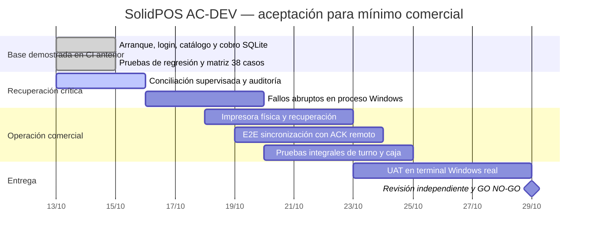

# SolidPOS — Seguimiento de aceptación y Gantt

**Última actualización:** 2026-10-13. **Rama:** AC-DEV. **Release:** NO-GO. Sin despliegue ni merge a main.

## Medición reproducible

La fuente autoritativa es el artefacto `solidpos-mvp-traceability.json` producido por CI de Windows, con la matriz [solidpos-mvp-acceptance-matrix.json](solidpos-mvp-acceptance-matrix.json). No sustituirlo por número de commits, PRs ni tests totales.

**Última línea base de CI confirmada:** workflow 38515386405 sobre el estado de rama `ab6c9583`, resultado **71/100 puntos de evidencia automatizada**, **29/38 escenarios acreditados**, **395 ejecuciones TRX**. Los nueve escenarios restantes requieren aceptación manual. Ese porcentaje no es readiness comercial.

**Iteración actual:** flujo supervisado de recuperación sin venta, verificaciones RBAC de segundo operador, bloqueo del worker obsoleto, ausencia de efectos financieros, auditoría transaccional, protección de interfaz WPF y pruebas negativas. Resultado pendiente de CI del último SHA: no otorgar incremento hasta validarlo.

## Gantt de alcance comercial

Las fechas posteriores al inicio son **estimaciones de planificación**, nunca promesas ni evidencia de avance. Las columnas de porcentajes reales se obtienen de TRX.

## Desglose comprobado (línea base de CI anterior)

| Requisito | Puntos automáticos acreditados | Peso máximo | Aceptación manual |
|---|---:|---:|---|
| MVP-01 Arranque | 8 | 10 | Pendiente |
| MVP-02 Login | 9 | 12 | Pendiente |
| MVP-03 Catálogo/carrito | 10 | 13 | Pendiente |
| MVP-04 Cobro atómico | 15 | 20 | Pendiente |
| MVP-05 Recibos | 5 | 10 | Pendiente |
| MVP-06 Sync y ACK | 7 | 10 | Pendiente |
| MVP-07 Caja | 6 | 10 | Pendiente |
| MVP-08 Recuperación | 11 | 15 | Pendiente |
| **Total** | **71** | **100** | **NO-GO** |

## Definición de terminado por requisito

Cada criterio debe tener método de prueba automatizada ejecutado en Windows y/o acta manual `START-05` ... `REC-07` con prueba reproducible, evidencia, SHA exacto, trazabilidad de defecto, revisor independiente y condición de autorización. El reporte de CI puede acreditar 71 puntos como máximo hasta ejecutar y validar manualmente el resto.

No habilitar POS real por el solo hecho de tener CI verde; autorizaciones, hardware y UAT son gates independientes.
